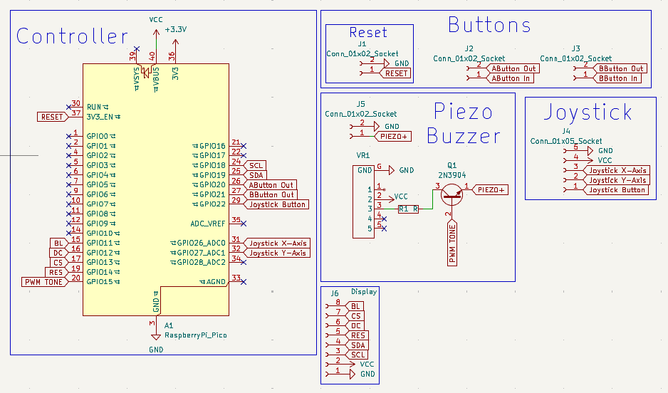
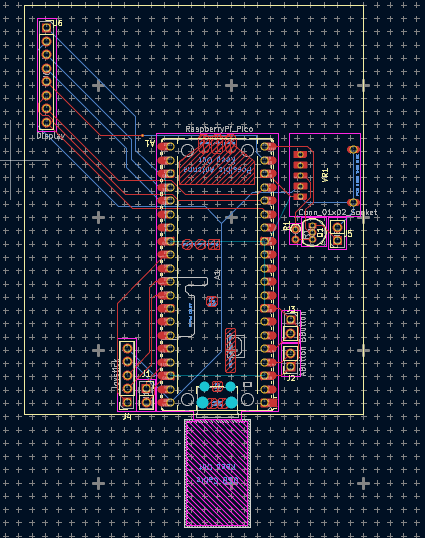
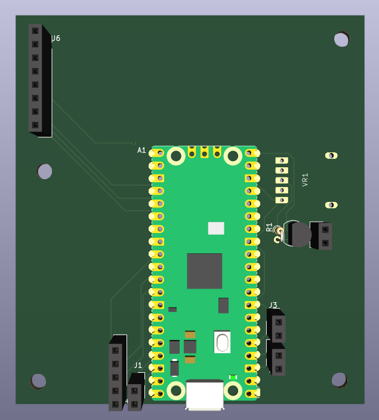

# Mini_GameConsole
## Description
This is a small mini GameConsole that you can play a few games on.
It has a joystick with a button, A and B buttons, Start and reset buttons, display and a piezo to make sound and effects.

The firmware is custom and built in C with the pico sdk.

## Schematic

## PCB

## Render

